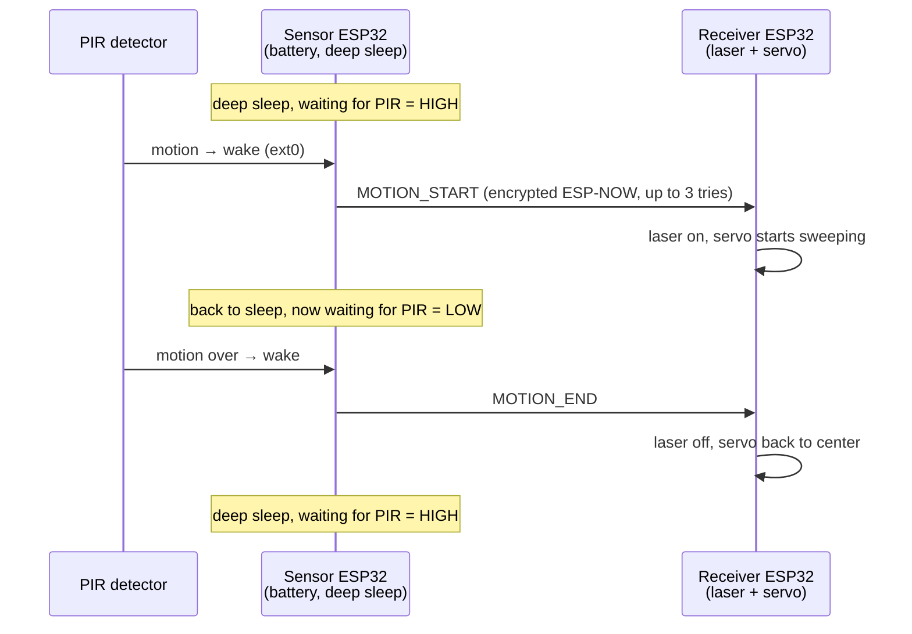

# ESP32 Laser System

**A battery-powered motion sensor that wirelessly triggers a sweeping laser.**

Two ESP32-S3 boards and no network in between. The sensor board sleeps until a PIR detector sees motion, wakes up, sends one encrypted ESP-NOW message, and goes straight back to sleep. The receiver board turns the laser on, sweeps it with a servo, and turns it off when the sensor reports that the motion has ended.

The project started as a Raspberry Pi toggling a GPIO pin. It moved to dedicated microcontrollers so the sensor could run on a battery and sit anywhere, with no wires and no Wi-Fi router.

---

## How it works



## Engineering highlights

| | |
|---|---|
| **Sleeps almost all the time** | The sensor spends nearly all its life in deep sleep and is awake only for the milliseconds it takes to send a message. It wakes on the PIR's *level*, alternating between "wake on HIGH" and "wake on LOW", so a single sleep/wake cycle covers both the start and the end of the motion. State that has to survive deep sleep (boot count, motion count, which edge it's waiting for) lives in RTC memory. |
| **No network, no pairing dance** | ESP-NOW sends frames directly between the two radios, so there's no router, no DHCP and no connection setup before the first byte. That's what makes the "wake, send, sleep" cycle short. Sends wait for the link-layer ACK and retry up to three times. |
| **Only the sensor can fire the laser** | Both boards share an encryption key (ESP-NOW's built-in CCMP), and the receiver ignores every sender except the sensor's MAC. Unencrypted frames from strangers still reach an ESP-NOW receive callback, so the sender check is what actually keeps them out, while encryption stops anyone from impersonating the sensor. The keys live in `secrets.h`, which git ignores. |
| **Fails safe** | The first thing the receiver does at boot is drive the laser off. The only automatic "on" is the short self-test below. If "motion end" is ever lost, a watchdog turns the laser off after 10 minutes. If ESP-NOW setup fails at boot, the receive callback is never registered, so the laser just never turns on. The receiver won't even compile until `SENSOR_MAC` is set, thanks to a `static_assert`. |
| **Radio callbacks stay tiny** | The ESP-NOW callback runs on the Wi-Fi task. It only validates the message and sets a `volatile` flag, and `loop()` does the actual GPIO and servo work. |
| **Servo without jitter** | The SG90 is driven straight from the LEDC PWM peripheral at 50 Hz with 14-bit resolution. When the laser goes off, the servo returns to center and the PWM output stops after half a second, so it doesn't buzz while idle. |
| **Portable across core versions** | The ESP-NOW callback signatures changed in Arduino-ESP32 3.0 and 3.3. Both sketches compile on either side of those changes via `ESP_ARDUINO_VERSION` checks. |
| **Self-test on power-up** | The receiver turns the laser on and wiggles the servo for 3 seconds at boot, so you can see at a glance that the wiring works. |

## Hardware

| Board | Parts | Wiring |
|---|---|---|
| **Sensor** | ESP32-S3, PIR (HC-SR501 or AM312), battery | PIR `OUT` → GPIO1 (must be an RTC GPIO to wake from deep sleep) |
| **Receiver** | ESP32-S3, laser module, SG90 servo | Laser signal → GPIO2 · servo signal → GPIO4 · servo power → 5V |

## Repository layout

```
camera/
  esp32_motion_sensor/    the battery sensor: deep sleep, PIR wake-up, ESP-NOW sender
  esp32_print_mac/        utility: prints a board's MAC, run once on each board
liser/
  esp32_laser_receiver/   laser + servo control, ESP-NOW receiver
```

## Setup

1. **Get the MAC addresses.** Flash `esp32_print_mac` on each board and read the Serial Monitor (115200 baud). It prints the exact line to paste:
   - the receiver's MAC goes into `RECEIVER_MAC` in `esp32_motion_sensor`
   - the sensor's MAC goes into `SENSOR_MAC` in `esp32_laser_receiver`
2. **Create the shared key.** In each of the two sketch folders, copy `secrets.example.h` to `secrets.h` and fill in random keys. Use the same keys in both folders. The example file includes a one-line Python command that generates them.
3. **Flash both boards** with the Arduino IDE (board: *ESP32S3 Dev Module*, Arduino-ESP32 core 3.x).

Both boards must use the same `ESPNOW_CHANNEL` (1 by default).

## Safety

This drives a real laser. Point it only where a reflection can't reach anyone's eyes. The 10-minute auto-off is a backstop, not a substitute for aiming it carefully.
